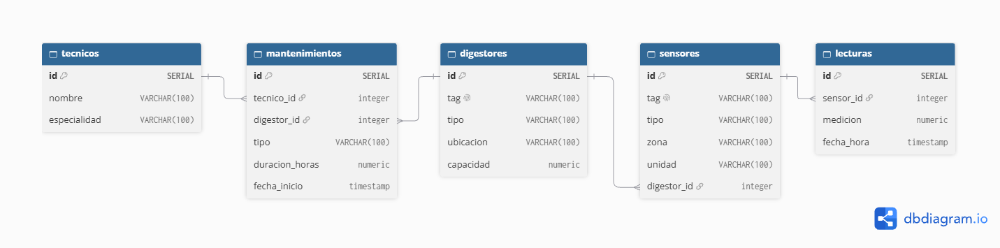

# Monitoreo y detección de fallas en digestores de una planta de celulosa
Se trabajó con datos simulados para interpretar anomalías en el funcionamiento
de los digestores de una planta. Se utilizó PostgreSQL, corriendo en Docker.
El modelo tiene 5 tablas, 11.424 lecturas de sensores y 12 consultas de análisis.

 **Hallazgo principal:** El análisis mostró que la falla de la bomba de circulación
de licor del DIG-L2 se podía haber detectado dos horas y media antes de la primera
intervención: la temperatura de cocción salió de su rango normal a las 14:00,
pero el técnico llegó a las 16:30.

## Contexto

El digestor es el equipo donde se cuece la madera a alta temperatura, entre 150 y 170 °C.
Esta cocción, con licor blanco, disuelve la lignina, la sustancia que mantiene unidas las
fibras de la madera, y deja libres las fibras de celulosa que forman la pulpa. Es el
corazón del proceso kraft.

Las variables monitoreadas son:

- **Temperatura por zona:** si la zona de cocción no llega a su rango, la lignina no se
  disuelve, la madera queda mal cocida y la pulpa sale de peor calidad.
- **Presión:** mantiene el licor líquido por sobre los 100 °C.
- **Nivel:** indica la altura de la columna de astillas y licor. Si baja demasiado, la
  cocción es más corta e incompleta; si sube demasiado, hay riesgo de atascos o rebalses.
- **Flujo de licor:** controla la proporción entre licor y madera. Con poco licor no se
  disuelve toda la lignina; con demasiado, se gasta químico de más y se dañan las fibras.

En una planta real, estos datos vendrían de una cadena: los sensores miden, el DCS los lee
y controla el proceso, y el historiador guarda cada variable con su valor y su hora. Un
ejemplo es AVEVA PI, el historiador más usado en la industria. En este proyecto, los datos
fueron simulados para imitar esa salida: la tabla `lecturas` guarda una medición de cada
sensor cada 15 minutos durante una semana.

## Modelo de datos

| Tabla | Contenido |
|---|---|
| `digestores` | los 3 digestores: tag, tipo, ubicación y capacidad |
| `sensores` | los 17 sensores: tag, tipo, zona, unidad y digestor |
| `lecturas` | una medición por sensor cada 15 minutos |
| `tecnicos` | los técnicos y su especialidad |
| `mantenimientos` | las intervenciones: técnico, digestor, tipo, fecha y duración |

### Decisiones de diseño

- **La ubicación en planta va en `digestores`, no en `sensores`:** un sensor está montado
  en un digestor, así que su ubicación depende del digestor. Repetirla en cada sensor
  violaría la 3FN, y si un digestor cambiara de línea habría que editar varias filas.
- **Los tags son únicos:** identifican equipos en la planta. La restricción `UNIQUE` hace
  que Postgres rechace un tag duplicado. El nombre de los técnicos no es único, porque dos
  personas pueden llamarse igual.
- **El tipo de digestor tiene un `CHECK`:** solo acepta `continuo` o `batch`, y evita
  valores inválidos o mal escritos.
- **`mantenimientos` es una tabla intermedia:** técnicos y digestores tienen una relación
  muchos a muchos (N:M). Se resuelve con dos FK (`tecnico_id` y `digestor_id`) y los datos
  propios de cada intervención.
- **La unidad queda en `sensores`:** depende del tipo de sensor, no de cada sensor, así que
  en 3FN iría en una tabla `tipos_sensor`. Decidí dejarla en `sensores` como simplificación,
  porque el modelo es pequeño.
- **Las FK son `NOT NULL`:** una lectura sin sensor, o un mantenimiento sin técnico, no
  tiene sentido.
- **Datos reproducibles con `setseed`:** fija la secuencia de números al azar, así
  cualquiera que ejecute el script obtiene los mismos resultados que aparecen en este README.

##  Datos simulados
Se simularon datos del 1 al 7 de octubre de 2026, con una lectura por sensor cada 15 minutos: 17 sensores × 672 instantes = 11.424 lecturas. Se generaron con `generate_series` para los instantes, `CROSS JOIN` para combinarlos con cada sensor, y `random()` con un `CASE` para dar a cada sensor valores dentro de su rango. Después, los eventos se aplicaron con `UPDATE`.

### Rangos normales

| Variable | Zona | Rango Normal |
|---|---|---|
| Temperatura | superior| 110 – 130 °C |
| Temperatura | cocción| 150 – 170 °C |
| Temperatura | inferior| 80 – 100 °C|
| Presión | --- | 7 – 12 bar |
| Nivel | --- | 40 – 90 % |
| Flujo de licor | --- | 200 – 400 m³/h|

### Eventos de la semana 

| Evento| Digestor| Inicio| Fin | Efecto en las lecturas
|---|---|---|---|---|
| Detención por correctivo | DIG-L1| 3 oct, 10:00 | 4 oct, 10:00 | temperatura 50–80 °C, presión 0–1 bar, flujo 0–5 m³/h
| Falla de la bomba de circulación | DIG-L2| 5 oct, 14:00| 6 oct, 09:00 | cocción 130–140 °C, flujo 100–150 m³/h
| Detención por correctivo | DIG-L2| 6 oct, 09:00| 6 oct, 21:00 | temperatura 50–80 °C, presión 0–1 bar, flujo 0–5 m³/h

El 5 de octubre a las 14:00, la bomba de circulación de licor del DIG-L2 empezó a fallar. A las 16:30 llegó la instrumentista, porque se sospechaba de un sensor, pero el problema siguió porque la causa era mecánica. Al día siguiente, a las 09:00, el mecánico encontró la falla en la bomba y detuvo el digestor durante 12 horas para repararla. 

Por su parte, DIG-L3 operó normal toda la semana y sirve como referencia para comparar. 

